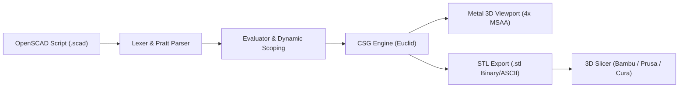
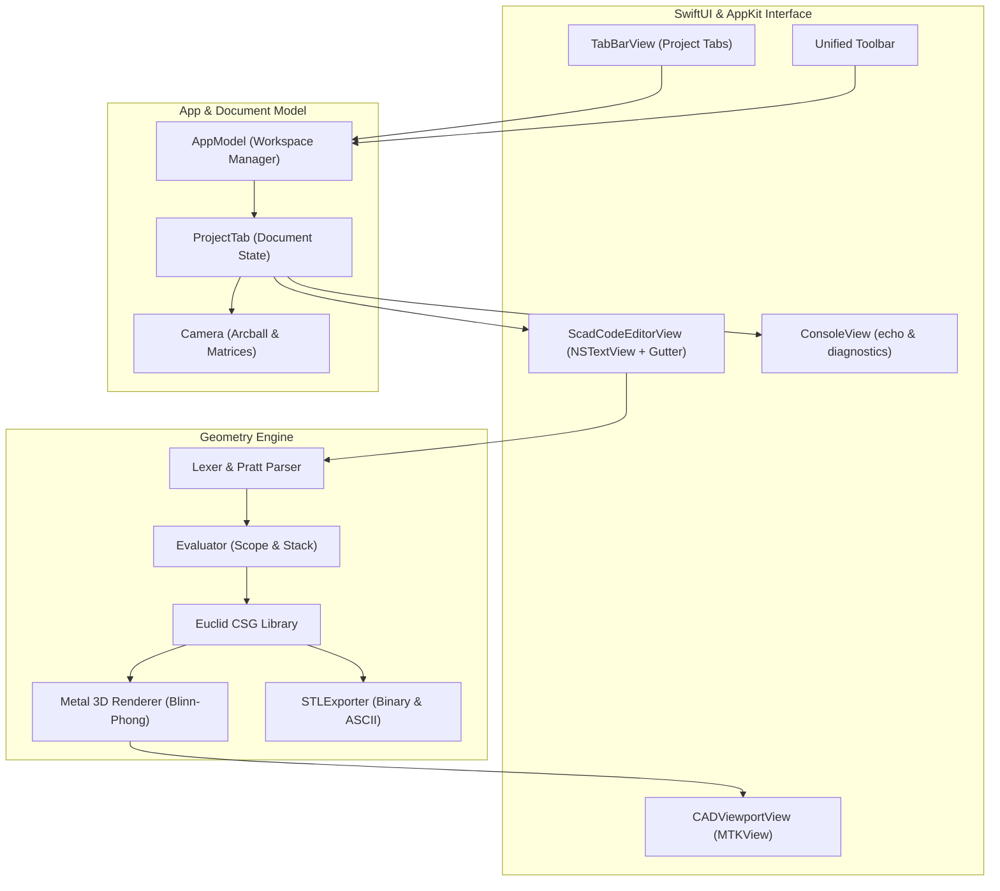

# Scad2Stl – User Manual & Documentation

> **Native OpenSCAD CAD environment, Metal 3D real-time viewport, and STL exporter for macOS on Apple Silicon.**

[](https://apple.com)
[](https://apple.com)
[](https://swift.org)
[-purple)](https://developer.apple.com/metal)
[](LICENSE)

---

## 📖 Table of Contents

1. [Overview](#-overview)
2. [System Requirements & Installation](#-system-requirements--installation)
3. [User Interface Overview](#-user-interface-overview)
4. [Multi-Project Tab Management](#-multi-project-tab-management)
5. [Toolbar & CAD Actions](#-toolbar--cad-actions)
6. [3D Viewport & Camera Controls](#-3d-viewport--camera-controls)
7. [File Management & STL Export](#-file-management--stl-export)
8. [Keyboard Shortcuts](#-keyboard-shortcuts)
9. [Supported OpenSCAD Language Features](#-supported-openscad-language-features)
10. [Tips for Performance & 3D Printing](#-tips-for-performance--3d-printing)
11. [Architecture & Development](#-architecture--development)
12. [Repository & Git Setup](#-repository--git-setup)

---

## 🌟 Overview

**Scad2Stl** is a lightweight, high-performance, fully native macOS application designed for creating, inspecting, and exporting parametric 3D CAD models using the OpenSCAD scripting language.

* **100% Native Swift & SwiftUI**: Crafted exclusively for macOS without legacy Qt, OpenGL, or CGAL dependencies.
* **Apple Silicon Optimized**: Leverages Apple Silicon's Unified Memory Architecture (UMA) and GPU for instant CSG geometry evaluation and smooth 3D rendering with **4x Multisample Anti-Aliasing (MSAA)**.
* **Multi-Project Workspace**: Tabbed interface allowing you to work on multiple scripts and models simultaneously with independent camera, editor, console, and geometry state.
* **High-Precision STL Export**: Fast binary and ASCII STL generation ready for slicing in Bambu Studio, PrusaSlicer, OrcaSlicer, or Cura.



---

## 💻 System Requirements & Installation

### Requirements
* **Operating System**: macOS 14.0 (Sonoma), macOS 15.0 (Sequoia), or later.
* **Hardware**: Any Mac equipped with an Apple Silicon chip (**M1, M2, M3, M4** or Pro / Max / Ultra variants).

### Running the App
1. The precompiled app bundle is located in the repository root as `Scad2Stl.app`.
2. Double-click `Scad2Stl.app` in Finder, or launch it from Terminal:
   ```bash
   open Scad2Stl.app
   ```
3. On first launch, macOS associates `.scad` files with Scad2Stl.

### Building from Source
Ensure Xcode Command Line Tools or the Xcode app is installed:
```bash
# Run automated test suite (24 unit tests)
swift test

# Build and package the self-contained release app bundle
./build_app.sh
```
The output bundle will be placed at `Scad2Stl.app`.

---

## 🖥️ User Interface Overview

The interface consists of a unified toolbar, a multi-project tab bar, and a responsive workspace split:

```
+---------------------------------------------------------------------------------------------+
| Toolbar: [New] [Open] [Save]  |  [Render] [Export STL]  | [Fit] [Reset] [Wire] [Grid] [Proj] |
+---------------------------------------------------------------------------------------------+
| Tab Bar: [ Untitled.scad × ] [ Project2.scad ● × ] [+]                                     |
+---------------------------------------------+-----------------------------------------------+
|                                             |                                               |
|  CODE EDITOR (Left Top)                     |  3D METAL VIEWPORT (Right)                    |
|  - Independent state per project tab        |  - Real-time Metal Blinn-Phong shading        |
|  - Native line numbers gutter               |  - 4x Hardware MSAA Anti-Aliasing             |
|  - Syntax highlighting                      |  - Smooth normal shading (> 45° crease angle) |
|  - Tab auto-indentation (4 spaces)          |  - XY Coordinate ground grid & RGB axes       |
|  - Drag & Drop file import                  |                                               |
|                                             |                                               |
|---------------------------------------------|                                               |
|  CONSOLE (Left Bottom)                      |  [HUD: Polygon Count • Dimensions • Time]     |
|  - echo(...) outputs                        |                                               |
|  - Warnings, errors, and export paths       +-----------------------------------------------+
+---------------------------------------------------------------------------------------------+
```

---

## 📑 Multi-Project Tab Management

Work on multiple designs at the same time without losing your place:

* **Independent Project State**: Each tab maintains its own:
  * OpenSCAD source code and undo/redo history.
  * File URL, title, and disk synchronization status.
  * Evaluated 3D mesh and Metal vertex buffers.
  * Arcball camera position (target, distance, orbit angle, projection mode).
  * Console log messages and compilation benchmark timings.
* **Unsaved Changes Indicator**: Tabs with modified, unsaved code display an orange dot (`●`) next to the document name.
* **Tab Controls**:
  * **New Tab**: Click the `+` button on the tab bar or press `Cmd+T`.
  * **Close Tab**: Click the `×` button on any tab or press `Cmd+W`.
  * **Switch Tabs**: Press `Cmd+Shift+]` (Next Tab) or `Cmd+Shift+[` (Previous Tab), or select from the **Tabs** menu.
* **Example Presets in Menubar**: Pre-built parametric samples (*CSG Tree*, *Perforated Cube*, *Parametric Wheel*, *Basketball Piggy Bank*) can be opened directly from the **Samples** menu into a new tab without overwriting your current work.

---

## 🛠️ Toolbar & CAD Actions

The unified top toolbar provides one-click access to all common CAD modeling and camera operations:

| Icon | Tooltip / Label | Shortcut | Action Description |
|---|---|---|---|
| <kbd>doc.badge.plus</kbd> | **New** | `Cmd + N` | Creates a new document tab with default template |
| <kbd>folder</kbd> | **Open** | `Cmd + O` | Opens an existing `.scad` script via native file chooser |
| <kbd>square.and.arrow.down</kbd> | **Save** | `Cmd + S` | Saves current script (`Cmd+Shift+S` for Save As) |
| <kbd>play.fill</kbd> | **Render** | `Cmd + R` / `F5` | Evaluates CSG geometry asynchronously on background thread |
| <kbd>shippingbox</kbd> | **Export STL** | `Cmd + E` | Exports model as binary STL with custom folder/filename picker |
| <kbd>viewfinder</kbd> | **Fit View to Model** | – | Automatically centers camera and fits zoom to model bounds |
| <kbd>arrow.counterclockwise</kbd>| **Reset Camera** | – | Resets camera to standard CAD isometric view |
| <kbd>cube.transparent</kbd> | **Toggle Wireframe** | – | Toggles between solid shading and triangular wireframe |
| <kbd>grid</kbd> | **Toggle Ground Grid** | – | Shows/hides the millimeter-accurate XY ground grid and axes |
| <kbd>cube</kbd> / <kbd>square</kbd> | **Projection** | – | Segmented switch between Perspective and Orthographic view |

---

## 🎥 3D Viewport & Camera Controls

The 3D CAD viewport uses standard engineering navigation patterns:

| Action | Mouse | Trackpad / Gestures |
|---|---|---|
| **Rotate (Orbit / Tumbling)** | Left click & drag | One-finger click & drag |
| **Pan (Translate View)** | Right click & drag | `Shift` + Click & drag |
| | *or* Middle mouse click & drag | *or* Two-finger swipe gesture |
| **Zoom (In / Out)** | Scroll wheel | Two-finger pinch-to-zoom |
| **Fit View** | Click **Viewfinder** button in toolbar | Centers and frames model in view |
| **Reset View** | Click **Reset** button (counterclockwise arrow) | Restores standard isometric perspective |
| **Projection Mode** | Toggle **Cube / Square** picker | Perspective view vs. Orthographic CAD projection |
| **Wireframe Mode** | Click **Wireframe** button | Renders triangle edges in real-time |
| **Ground Grid** | Click **Grid** button | Toggles millimeter-spaced XY grid & RGB coordinate axes |

---

## 📂 File Management & STL Export

### 1. Opening Files
* Click **Open** (`Cmd+O`) in the toolbar or menu.
* Drag and drop any `.scad` file directly onto the window.
* If the active tab is an unedited, blank "Untitled.scad" tab, the file replaces it; otherwise, a **new project tab** is opened automatically.
* Once loaded, the script evaluates immediately, and the camera fits to the model bounds.

### 2. Saving Files
* Press `Cmd+S` to save directly to disk. If the document hasn't been saved yet, a native Save dialog appears automatically.
* Press `Cmd+Shift+S` to "Save As..." to a different path or filename.

### 3. STL Export for 3D Printing
* Press `Cmd+E` or click **Export STL** in the toolbar.
* Choose any destination folder or create new folders on the fly.
* The exporter automatically suggests the matching model name (e.g. `MyModel.scad` $\rightarrow$ `MyModel.stl`).
* Exports high-precision **Binary STL** files compatible with all modern 3D slicers (Bambu Studio, PrusaSlicer, OrcaSlicer, Ultimaker Cura, Simplify3D).

---

## ⌨️ Keyboard Shortcuts

| Shortcut | Menu / Action | Description |
|---|---|---|
| `Cmd + T` | **New Tab** | Opens a new project in a separate tab |
| `Cmd + W` | **Close Tab** | Closes the active project tab |
| `Cmd + Shift + ]` | **Next Tab** | Cycles to the next open tab |
| `Cmd + Shift + [` | **Previous Tab** | Cycles to the previous open tab |
| `Cmd + N` | **New Document** | Creates a new document tab |
| `Cmd + O` | **Open...** | Opens a file from disk |
| `Cmd + S` | **Save** | Saves current tab script |
| `Cmd + Shift + S` | **Save As...** | Saves script to a new file location |
| `Cmd + R` | **Render** | Triggers background CSG re-compilation |
| `Cmd + E` | **Export STL...** | Opens STL export dialog |
| `Tab` | **Indent** | Inserts 4 spaces at cursor in code editor |

---

## 📐 Supported OpenSCAD Language Features

### 1. 3D Primitives
* `cube(size, center = false)`: Box primitives with uniform scalar `cube(10)` or vector dimensions `cube([10, 20, 30], center = true)`.
* `sphere(r, d, $fn)`: Sphere defined by radius `r` or diameter `d`. Local `$fn` resolution supported.
* `cylinder(h, r/d, r1/d1, r2/d2, center = false, $fn)`: Cylinders and conical frustums aligned with Z-axis.
* `polyhedron(points, faces)`: Custom polyhedral meshes from vertex and face index lists.

### 2. 2D Primitives
* `square(size, center = false)`: Rectangles and squares in the XY plane.
* `circle(r, d, $fn)`: 2D disks and circles with custom `$fn` resolution.
* `polygon(points)`: Arbitrary 2D closed paths.

### 3. Boolean CSG Operations
* `union() { ... }`: Combines multiple solid bodies.
* `difference() { A(); B(); ... }`: Subtracts subsequent child objects from the first object.
* `intersection() { ... }`: Computes the intersecting volume shared by all child objects.

### 4. Convex Hull
* `hull() { ... }`: Computes the minimal 3D convex hull encompassing all children (ideal for organic shapes, filleted brackets, and smooth joint transitions).

### 5. Extrusions
* `linear_extrude(height, center = false, twist = 0, slices = ...)`: Extrudes 2D shapes into 3D, with optional helical `twist` for threads and spiral designs.
* `rotate_extrude(angle = 360, $fn = ...)`: Revolves a 2D profile around the Z-axis (e.g. tori, rings, vases).

### 6. Control Flow & Language Constructs
* `module name(...) { ... }`: Custom reusable parametric modules with default arguments.
* `function name(...) = ...`: Pure mathematical functions with local expressions.
* `for (i = [start : step : end])`: Loops with support for multi-variable ranges and nested geometry generation.
* `if (condition) { ... } else { ... }`: Conditional geometry branching.
* `let(var = val, ...) [ ... ]`: Local variable scopes inside expressions and list comprehensions.
* `echo(...)`: Formatted debug printing to the console panel.
* Special Variables: `$fn`, `$fa`, `$fs`, `$children`, `$t`.
* Math Library: `sin`, `cos`, `tan`, `asin`, `acos`, `atan`, `atan2`, `sqrt`, `pow`, `abs`, `floor`, `ceil`, `round`, `min`, `max`, `exp`, `log`, `ln`, `sign`.

---

## 💡 Tips for Performance & 3D Printing

1. **Preview vs. Final Render (`$fn`)**:
   * During interactive modeling, keep `$fn = 30` to `40` for instantaneous feedback (< 50 ms).
   * For final STL export for 3D printing, set `$fn = 80` to `120` to produce ultra-smooth curves without visible facets.
2. **Boolean Hygiene**:
   * When cutting holes with `difference()`, ensure the cutting tool extends slightly beyond the target surface (e.g., `+ 0.1 mm` overlap) to prevent coplanar artifact faces (non-manifold geometry).
3. **Manifold Geometry**:
   * Scad2Stl generates watertight, 2-manifold triangle meshes guaranteed to slice cleanly in Bambu Studio and PrusaSlicer.

---

## 🏛️ Architecture & Development



### Running Tests
The test suite covers lexing, AST parsing, CSG evaluation, mathematical functions, STL file export, and multi-tab state management:
```bash
DEVELOPER_DIR=/Applications/Xcode.app/Contents/Developer swift test
```

---

## 📦 Repository & Git Setup

* **Remote Repository**: [`git@github.com:HerrTete/Scad2Stl.git`](git@github.com:HerrTete/Scad2Stl.git)
* **Origin Branch**: `main`

To clone and set up:
```bash
git clone git@github.com:HerrTete/Scad2Stl.git
cd Scad2Stl
./build_app.sh
open Scad2Stl.app
```

---

*Authored with ❤️ for macOS and Apple Silicon.*
